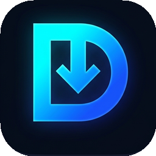

<p align="center">
  
</p>

<h1 align="center">Duytai Downloader (v7.5)</h1>

<p align="center">
  <b>Động cơ tăng tốc tải xuống đa nền tảng — Kiến trúc Hybrid Native có Chữ Ký Số (Code Signing) cho Windows, macOS & Android</b>
</p>

---

## ⚙️ Cấu Hình Hệ Thống & Thông Số Kỹ Thuật Theo Từng Nền Tảng

Mọi phiên bản được biên dịch native và ký số xác thực riêng cho từng hệ điều hành, sử dụng chung hệ thuật toán lõi **Duytai Engine v7.5**:

| Thông Số Cấu Hình | **Windows (Desktop 64-Bit)** | **macOS (Universal App)** | **Android (Mobile Native)** |
| :--- | :--- | :--- | :--- |
| **Tệp Thực Thi / Bộ Cài** | `Duytai.exe` (`PE32+ x86_64`) / `Duytai-Setup.exe` | `Duytai.app` -> `Duytai-macOS-Universal.dmg` | `Duytai-Android.apk` (`com.doanduy.duytai`) |
| **Chữ Ký Số & Bảo Mật OS** | Authenticode RSA-2048 SHA-256 (`DOANDUY Software`) + `asInvoker` Manifest + Gỡ `Zone.Identifier` | Hardened Runtime `codesign` + `entitlements.plist` + Gỡ `com.apple.quarantine` | APK Signature Scheme **v1 + v2 + v3 + v4** (RSA-2048) + R8 Minify |
| **Ngôn Ngữ & UI Host** | C# WinForms + Edge WebView2 (`HyperIDM.cs`) | Swift Cocoa AppKit + `WKWebView` (`DuytaiMac.swift`) | Kotlin Native UI + Foreground Service (`dataSync`) |
| **Kiến Trúc CPU** | x64 (64-bit Native) | Universal Binary (`arm64` Apple Silicon M1–M4 + `x86_64` Intel) | `arm64-v8a` / `armeabi-v7a` / `x86_64` |
| **Hệ Điều Hành Tối Thiểu** | Windows 10 / 11 (64-bit) | macOS 11.0 Big Sur trở lên | Android 8.0 (`API 26`) – Android 15 (`API 35`) |
| **Động Cơ Tải Đa Luồng** | Node.js Core (`engine.js`) — **64 / 128 luồng** song song | Node.js Core (`engine.js`) — **64 / 128 luồng** song song | Kotlin Coroutines + `FileChannel` — **32 / 64 / 128 luồng** |
| **Cơ Chế Ghi Đĩa** | Sparse In-Place + Zero-Copy `writev` (`committed` offset) | Preallocated In-Place + Zero-Copy `writev` (`committed` offset) | `RandomAccessFile.setLength()` + Seekable `FileChannel` |
| **Bộ Đệm Coalescing** | Tự động điều chỉnh **256 KB → 2 MB** theo BDP | Tự động điều chỉnh **256 KB → 2 MB** theo BDP | Direct `ByteBuffer` `128 KB` + giới hạn `Semaphore(3)` |
| **Lưu Trữ & Phân Loại** | `%USERPROFILE%\Downloads\Duytai\<Category>` | `~/Downloads/Duytai/<Category>` | `MediaStore.Downloads` (`Download/Duytai/<Category>`) |
| **Cổng Điều Khiển Local** | `127.0.0.1:17890` (`X-Duytai-Token` + Host/Origin Guard) | `127.0.0.1:17890` (`X-Duytai-Token` + Host/Origin Guard) | Nội bộ qua Android Service Binder |
| **Giới Hạn RAM Engine** | `--max-old-space-size=384` MB + Win32 JobObject | `--max-old-space-size=384` MB + Signal Trap | Heap Android ART tự quản + Partial WakeLock |

---

## 🧠 Kiến Trúc Động Cơ Cốt Lõi (Duytai Core v7.5)

1. **Wave-0 Parallel Segment & Dynamic Work-Stealing**:
   - Chia tệp thành tối đa **64 hoặc 128 phân đoạn** ngay sau bước `HEAD` / `Range: bytes=0-0`.
   - Khi một luồng hoàn thành sớm, hệ thống tự động chia đôi phần còn lại của phân đoạn lớn nhất (`_tryStealFromLargestSegment`) để không bị nghẽn đơn luồng ở cuối tệp.
2. **Google "The Tail at Scale" Hedged Racing**:
   - Tự động phát hiện phân đoạn bị treo (`> 900 ms` không nhận dữ liệu) hoặc chạy chậm ở vùng 6% cuối tệp, phóng luồng đua dự phòng sang IP biên khác; bên nào nhận dữ liệu hợp lệ trước sẽ chiếm quyền ghi nguyên tử.
3. **AIMD Congestion Control (HTTP `429` / `503` Recovery)**:
   - Tự động giảm một nửa số kết nối khi máy chủ phản hồi giới hạn tốc độ (`Retry-After` / TCP Reset) và phục hồi tăng dần (`+2` luồng sau mỗi 4 phân đoạn hoàn tất).
4. **Multi-IP DNS Pool & EWMA Edge PoP Scoring**:
   - Phân giải toàn bộ danh sách IP của CDN, chấm điểm độ trễ theo hàm mũ EWMA và tự động cách ly IP lỗi trong `15s`.
5. **Khôi Phục & Xác Thực Toàn Vẹn**:
   - Nhật ký trạng thái `.hyper.json` cho phép Tạm dừng / Tiếp tục giữ nguyên từng byte đã ghi.
   - Tự động tính mã băm **SHA-256**, hỗ trợ giải mã trực tiếp liên kết `ipsw.me` qua Apple IPSW API v4.

---

## 🌐 Tiện Ích Trình Duyệt & Phân Loại Định Dạng

- **Extension Manifest V3 (`extension/`)**:
  - Mã cố định: `knpgakkbngbpcijjehpjflnflccdlaon` (hỗ trợ Google Chrome, Microsoft Edge, Cốc Cốc, Brave, Vivaldi, Arc và Firefox).
  - Giao tiếp qua **Native Messaging (`com.duytai.idm`)** bảo vệ bằng Origin Whitelist (`127.0.0.1`, `localhost`, `chrome-extension://`, `moz-extension://`).
  - Bắt liên kết ngay ở pha tiền tải (`document_start` + `downloads.onDeterminingFilename`), không để trình duyệt tạo tệp rác "Đã hủy".
- **Hỗ trợ >60 định dạng tệp & Phân loại tự động**:
  - `Firmware_ISO`: `.ipsw`, `.iso`, `.img`, `.bin`, `.dmg`, `.pkg`, `.msu`
  - `Compressed`: `.zip`, `.rar`, `.7z`, `.gz`, `.gzip`, `.bz2`, `.tar`, `.z`, `.arj`, `.lzh`, `.ace`, `.sea`, `.sit`, `.sitx`, `.xz`, `.zst`, `.r0*`, `.r1*`
  - `Programs`: `.exe`, `.msi`, `.apk`, `.xapk`, `.obb`, `.deb`, `.rpm`
  - `Video`: `.mp4`, `.mkv`, `.avi`, `.mov`, `.wmv`, `.m4v`, `.mpg`, `.mpeg`, `.mpe`, `.3gp`, `.asf`, `.ogv`, `.rm`, `.rmvb`, `.qt`, `.webm`
  - `Music`: `.mp3`, `.aac`, `.m4a`, `.wav`, `.wma`, `.ogg`, `.aif`, `.mpa`, `.ra`, `.flac`, `.plj`
  - `Documents`: `.pdf`, `.ppt`, `.pptx`, `.pps`, `.doc`, `.docx`, `.xls`, `.xlsx`, `.tif`, `.tiff`, `.epub`

---

## 📦 Hướng Dẫn Cài Đặt

### 1. Windows 10 / 11 (64-Bit)
- Tải **`Duytai-Setup.exe`** từ mục [Releases](https://github.com/Doanduy09/HyperIDM-Ultra/releases) và chạy trực tiếp.
- Trình cài đặt tự động triển khai vào `%LOCALAPPDATA%\Programs\Duytai`, đăng ký Native Messaging cho trình duyệt, giao thức `duytai://`, lệnh CLI `duytai` và biểu tượng Desktop/System Tray.
- **Lệnh CLI nhanh**:
  ```powershell
  duytai "https://example.com/file.zip" 64
  ```

### 2. MacBook (macOS Apple Silicon & Intel)
- Tải **`Duytai-macOS-Universal.dmg`** từ [Releases](https://github.com/Doanduy09/HyperIDM-Ultra/releases), kéo `Duytai.app` vào `/Applications`.
- Chạy script cấu hình trình duyệt & tự khởi động:
  ```bash
  bash /Applications/Duytai.app/Contents/Resources/Install-Duytai-macOS.sh
  ```
- *(Yêu cầu máy Mac đã cài Node.js 20+ via Homebrew `brew install node` hoặc `nodejs.org`).*

### 3. Android (8.0 – 15)
- Tải **`Duytai-Android.apk`** từ [Releases](https://github.com/Doanduy09/HyperIDM-Ultra/releases) và cài đặt trực tiếp.
- Hỗ trợ dán link, nhận link qua menu **Chia sẻ (Share Sheet)** hoặc liên kết `duytai://`, trình duyệt bắt link nội bộ (**Web Sniffer**), chọn nhiều tệp để xóa hàng loạt và thông báo tiến trình chạy nền ổn định.
